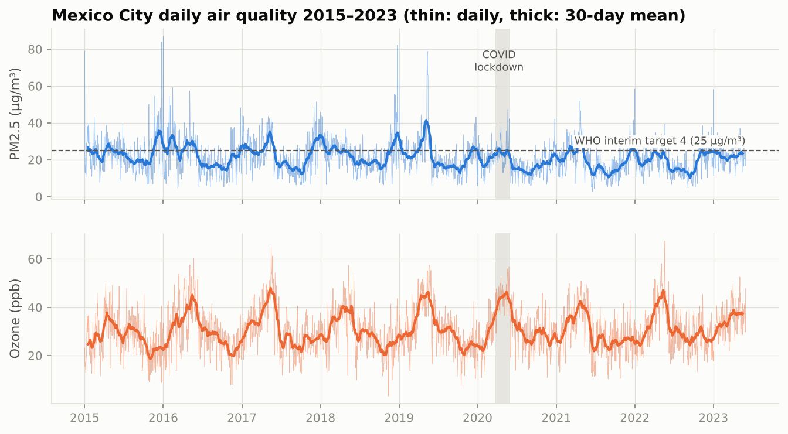
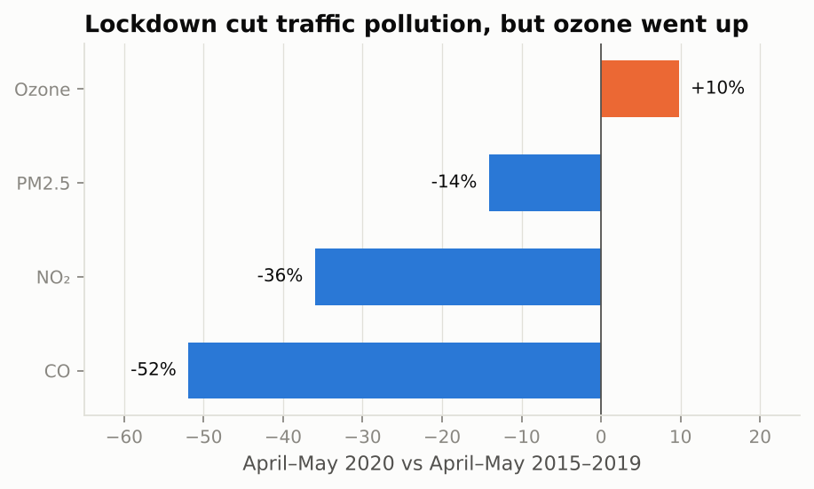
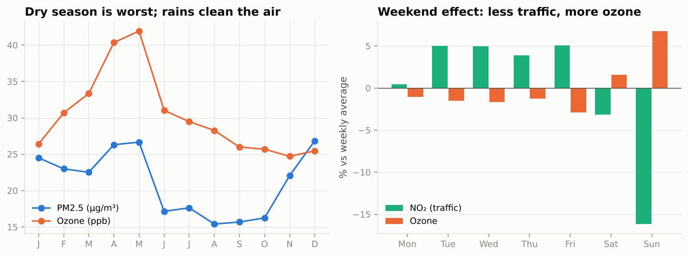
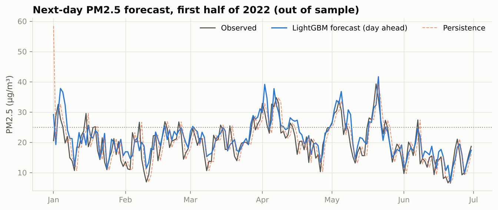
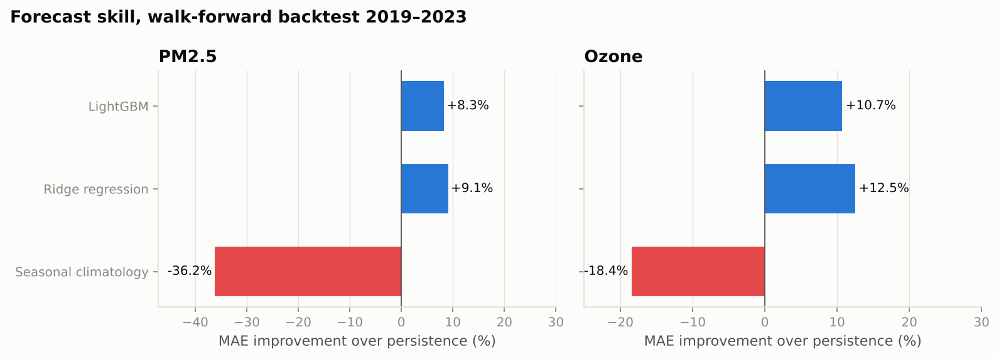

# Mexico City Air Quality: SQL Analysis and Next-Day Forecasting

[](https://github.com/c4r0l13/cdmx-air-quality-forecasting/actions/workflows/ci.yml)


Eight and a half years of **real daily measurements** from Mexico City's monitoring network (SIMAT: RAMA pollutants + REDMET weather, January 2015 – May 2023, 3,073 days), used to answer two questions:

1. **What drives air pollution in the city?** Answered with SQL on a reproducible SQLite database.
2. **Can we warn people a day in advance?** Answered with next-day forecasts of PM2.5 and ozone, evaluated in a walk-forward backtest over 2019–2023.

> *Resumen en español:* análisis y pronóstico de la calidad del aire en la CDMX con datos reales de SIMAT (2015–2023). Incluye consultas SQL, el efecto del confinamiento por COVID, el "efecto fin de semana" del ozono y un modelo que avisa con un día de anticipación si el PM2.5 superará 25 µg/m³ (ROC-AUC 0.90).



## Key findings

**1. The 2020 lockdown cut traffic pollution, but ozone went up.** April–May 2020 against the same months of 2015–2019: CO **−52%**, NO₂ **−36%**, PM2.5 −14%, and ozone **+10%**. Less NO from traffic means less ozone is "titrated" (NO + O₃ → NO₂ + O₂), so ozone rises when traffic falls. Cutting cars alone does not solve Mexico City's ozone problem.



**2. The weekend effect.** On Sundays NO₂ is 16% below its weekly average and ozone is 7% above it, the same chemistry seen every week. The dry season (December–May) is the worst for particles, and ozone peaks in April–May with strong sun and stagnant air. The rainy season cleans the air.



**3. The worst days have identifiable causes.** Of the 10 worst PM2.5 days, four are Christmas or New Year's Day (fireworks) and the other six are 11–16 May 2019, when wildfire smoke triggered an environmental contingency. Days in the windiest quartile average 16 µg/m³ of PM2.5, versus 25 µg/m³ in the calmest quartile.

**4. Particles have been improving.** The share of days above 25 µg/m³ PM2.5 (WHO interim target 4) fell from 38% in 2015 to 20–26% in 2021–2023. Days above the WHO guideline of 15 µg/m³ are still the norm (about 7 in 10 days in 2021–2023).

All SQL behind these numbers: [`sql/questions.sql`](sql/questions.sql) → [`reports/sql_answers.md`](reports/sql_answers.md).

## Forecasting: will tomorrow be a bad air day?

Each model uses only what is known at the end of day *t*: today's pollutants and weather, lags and 7-day means, plus the calendar of day *t+1* (season, weekday, Christmas/New Year). It is retrained every year on all previous years and tested on the next one (2019 → 2023, 1,611 test days).

| Next-day PM2.5 (µg/m³) | MAE | vs persistence |
|---|---:|---:|
| Persistence (tomorrow = today) | 4.17 | – |
| Seasonal climatology | 5.68 | −36% |
| **Ridge regression** | **3.79** | **+9.1%** |
| LightGBM | 3.83 | +8.3% |

| Next-day ozone (ppb) | MAE | vs persistence |
|---|---:|---:|
| Persistence | 4.73 | – |
| **Ridge regression** | **4.14** | **+12.5%** |
| LightGBM | 4.22 | +10.7% |

**Early warning for PM2.5 above 25 µg/m³** (23% of test days):

| Model | ROC-AUC | PR-AUC | Brier score |
|---|---:|---:|---:|
| Persistence (alert if today exceeded) | – | – | 0.169 |
| Logistic regression | 0.900 | 0.719 | **0.106** |
| LightGBM | 0.898 | **0.733** | 0.108 |





What the backtest says:

- **Persistence is a strong baseline for air quality,** and seasonal averages are much worse than it. Both models beat it by 9–13%, which is a realistic margin for daily data without weather forecasts as inputs.
- **A linear model is as good as gradient boosting** here. With about 2,000 training days and mostly linear relationships, the simpler and more explainable model wins.
- **2019 is the hardest year.** The May 2019 wildfire episode was unlike anything in the training data. No model beat persistence by much that year, which is the honest limit of learning from history.
- **The alert model cuts the Brier score by 37% versus persistence,** so its probabilities are much more informative than "same as today".

## How this project evolved

This repository merges and rebuilds three earlier BEDU course projects from my previous GitHub account ([caro1ie](https://github.com/caro1ie)):

- an SQL database and query exercise on air quality (module 1),
- a proposal for intelligent air-quality monitoring and prediction for Mexico written in R (module 2),
- and an exploratory notebook on SIMAT data from a data-analysis class.

The original SQL exercise used a synthetic Kaggle dataset. This version switches to **real SIMAT measurements**, keeps the SQL-first approach with SQLite so it runs anywhere, and adds the forecasting system the module-2 proposal described, with a proper out-of-sample evaluation.

## Reproduce

```bash
git clone https://github.com/c4r0l13/cdmx-air-quality-forecasting.git
cd cdmx-air-quality-forecasting
python -m venv .venv && source .venv/bin/activate
make install
make data     # daily SIMAT averages (~300 KB)
make run      # SQL answers + forecasts + figures -> reports/
make test
```

## Project structure

```
cdmx-air-quality-forecasting/
├── sql/
│   ├── schema.sql        # tables + joined daily view
│   └── questions.sql     # 7 analytical questions, one SQL block each
├── src/airq/
│   ├── db.py             # builds SQLite, runs the questions -> reports/sql_answers.md
│   ├── forecast.py       # leak-free features, baselines, walk-forward backtests
│   └── pipeline.py       # everything + figures
├── tests/                # no look-ahead in features, climatology, SQL parser
└── reports/              # sql_answers.md, results.md, metrics.json, figures/
```

## Limitations and next steps

- **Daily city-wide averages.** Official contingencies are declared on hourly, station-level ozone and PM peaks. Hourly station data would allow forecasting the contingency itself.
- **No weather forecast as input.** Adding next-day forecast wind and temperature, which an operational system would have, is the most promising improvement.
- Ozone units are ppb as reported by SIMAT. Thresholds use WHO 2021 guidelines rather than the Mexican standard NOM-025-SSA1-2021, whose limits are being phased in.

## Data

Sistema de Monitoreo Atmosférico de la Ciudad de México (SIMAT), via [datos.cdmx.gob.mx](https://datos.cdmx.gob.mx/dataset/red-automatica-de-monitoreo-atmosferico). Daily averages as prepared by J. A. Martínez-Cadena for the course [Análisis de datos atmosféricos](https://github.com/jamc88/Analisis-datos-atmosfericos).
